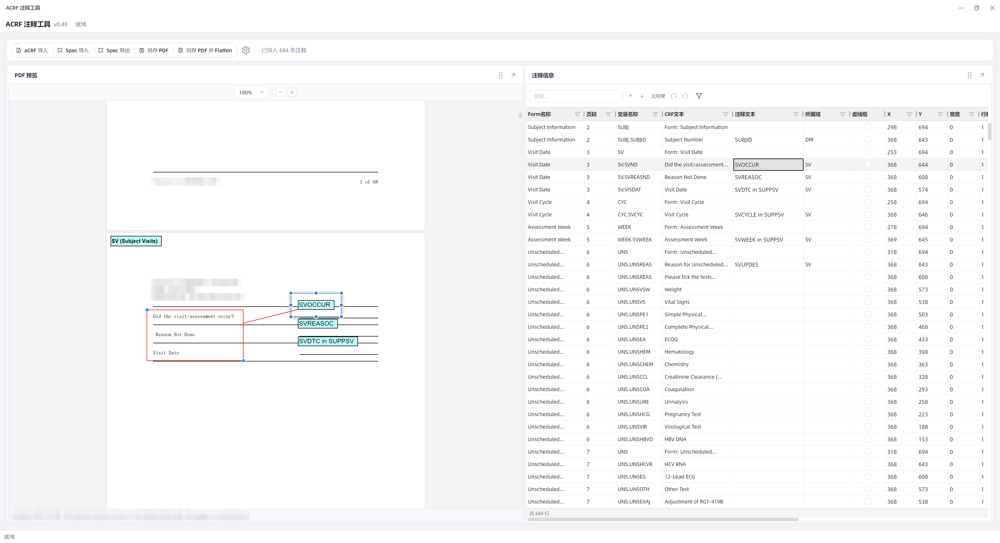
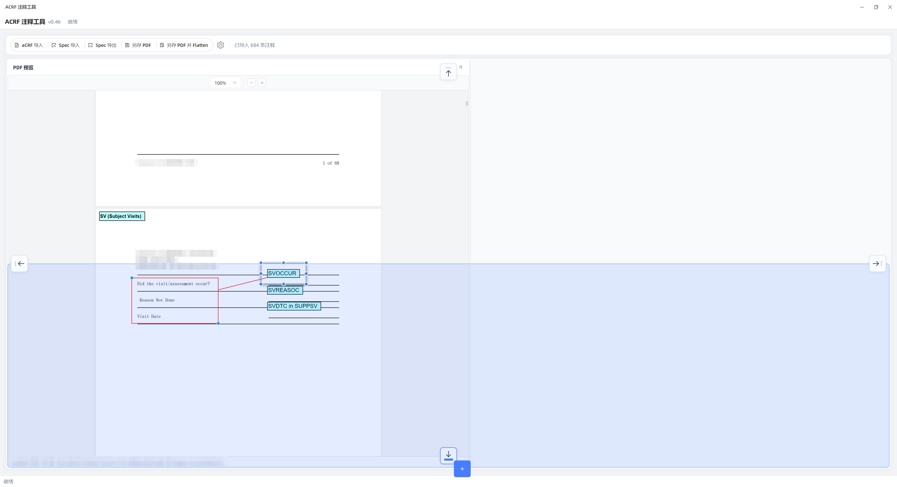

# ACRF 注释工具

用于在 PDF 表单上查看、编辑和管理 aCRF 注释，配合 Excel 注释 Spec 完成标注、检查和导出。

当前版本：**v0.46**。版本变更见 [更新日志](CHANGELOG.md)。

## 快速开始

1. 在 Windows 上解压完整程序包，双击 `AcrfAnnotationTool.exe` 启动。请保留解压后的全部文件，不要只复制主程序。
2. 点击顶部的 **aCRF 导入**，选择需要标注的 PDF。
3. 点击 **Spec 导入**，选择与该 PDF 对应的 Excel `.xlsx` 注释文件。
4. 在“注释信息”表格中修改注释，在“PDF 预览”中检查位置和显示效果。
5. 完成编辑后，点击 **Spec 导出** 保存表格数据，再点击 **另存 PDF** 保存带注释的 PDF。

> 导入 Spec 会替换当前注释表格，并同步替换 PDF 中的对应注释，不是追加数据。重新导入前，请先导出需要保留的结果。

## 界面预览

以下为 v0.46 界面截图，部分信息已做模糊处理。

### PDF 预览与注释编辑

左侧查看 PDF、页面顶部的域标签和红色引导标注，右侧编辑注释信息。点击表格记录可定位到 PDF 注释，点击 PDF 注释也可定位到对应记录。

### 自定义面板布局

拖动面板时会显示停靠方向和目标区域预览，可按工作习惯调整 PDF 与注释信息面板的位置。

## 顶部工具栏

| 按钮 | 用途 |
| --- | --- |
| aCRF 导入 | 打开 PDF，查看页面及已有注释。 |
| Spec 导入 | 从 Excel `.xlsx` 文件载入注释信息。 |
| Spec 导出 | 将当前全部注释记录保存为 Excel `.xlsx` 文件。 |
| 另存 PDF | 保存带有可编辑注释的 PDF，便于后续继续调整。 |
| 另存 PDF 并 Flatten | 将本工具的注释固定到页面中，适合不需要继续编辑注释的输出版本。 |
| 设置（齿轮按钮） | 调整域标签位置、注释语言以及是否允许直接编辑 PDF 注释。 |

## 查看和定位 PDF

- 滚动鼠标滚轮浏览页面。
- 滚动时，PDF 预览底部会显示页码导航条；停止操作一段时间后自动隐藏。
- 点击上一页、下一页按钮翻页，或在页码框中输入页码后按 `Enter` 跳转。
- 使用预览上方的缩放比例、加号和减号调整大小；也可以将鼠标放在 PDF 区域，按住 `Ctrl` 滚动滚轮。
- 在注释表格中点击记录，可快速定位其对应的 PDF 注释。

## 编辑注释信息

### 修改字段

1. 在表格中选中要修改的单元格。
2. 双击单元格，或按 `F2` / `Enter` 开始编辑。
3. 修改内容后按 `Enter` 提交；普通单元格编辑时按 `Esc` 可取消本次修改。
4. 到 PDF 预览中检查注释文字、位置和大小。

常用字段包括注释文本、所属域、虚线框、X/Y 坐标、宽度、行数和 Callout。页码等只读字段不能直接修改。

### 选择、复制和粘贴

- **连续选区**：按住鼠标左键拖动，或先选中一个单元格，再按住 `Shift` 点击另一单元格。
- **追加选区**：按住 `Ctrl` 点击或拖动，添加其他单元格或区域。
- **复制内容**：选中单元格后按 `Ctrl+C`。
- **粘贴内容**：选中目标单元格或区域后按 `Ctrl+V`，从选区左上角开始填入。
- **重复填充**：复制一个值后，可选中多个单元格再粘贴，快速填写相同内容。
- **清空内容**：选中单元格后按 `Delete`，只清空可编辑内容，不删除整条注释。

粘贴不会自动增加记录；只读列、超出表格范围或格式不匹配的内容不会写入。

### 右键菜单

在注释信息表格中右键点击记录，可执行以下操作：

| 操作 | 说明 |
| --- | --- |
| 复制 | 复制当前整条注释，生成一条新记录；与 `Ctrl+C` 复制单元格内容不同。 |
| 大写转换 | 将注释文本转换为大写。 |
| 批量调整 X / Y 坐标 | 为全部注释统一调整对应方向的位置，不限于当前选区或筛选结果。 |
| 删除 | 确认后删除当前记录及对应 PDF 注释。 |

> 批量调整坐标前建议先导出备份。需要删除整条注释时，请使用表格右键菜单中的“删除”，不要用 `Delete` 代替。

## 搜索、替换和检查错误

### 搜索与筛选

1. 点击表格搜索框，或在表格中按 `Ctrl+F`。
2. 输入关键字，表格会筛选显示匹配的记录。
3. 使用搜索框旁的上、下箭头浏览匹配项；在搜索框中也可按 `Enter` / `Shift+Enter`。
4. 清空搜索内容，或在搜索框中按 `Esc` 关闭搜索。

还可以通过列标题旁的筛选按钮按列筛选；需要恢复查看时清除相应筛选条件。

### 替换选区内容

1. 先选中需要替换的单元格区域。
2. 按 `Ctrl+H` 打开替换窗口。
3. 输入查找内容和替换内容，选择替换当前匹配或全部替换。

替换范围是打开窗口时选中的单元格，不是整张表。只读列和勾选框列不参与替换。

### 只看错误记录

点击表格工具栏的 **仅显示有错误的行** 筛选按钮，集中处理存在校验错误的记录。关闭该筛选后可退出此模式；其他搜索或列筛选条件仍然有效。

### 撤销和重做

使用表格工具栏的撤销、重做按钮，或按 `Ctrl+Z` / `Ctrl+Y`。正在输入文字时，快捷键优先处理文本框内的修改。

不要将撤销当作备份；导入 Spec 会清空撤销历史，也不要假定所有 PDF 直接编辑操作都能撤销。

## 在 PDF 中调整注释

- **移动位置**：选中注释并拖动。
- **修改文字、大小和样式**：先打开设置，勾选 **允许编辑 PDF 注释（文本、大小和样式）** 并确认。
- **修改文字**：双击注释进入编辑，`Enter` 换行，`Esc` 结束编辑并保留修改。
- **调整大小**：选中注释后，拖动边缘或四角的蓝色控制点。
- **修改样式**：右键点击注释，使用菜单中的相应选项。

关闭“允许编辑 PDF 注释”后，仍可选中和拖动注释位置。

> PDF 文字编辑中的 `Esc` 是结束编辑并保留修改，与普通表格单元格中的取消编辑不同。

## 添加 Callout 引导标注

Callout 是连接注释和 CRF 内容的红色引导标记，支持左括号、右括号、上括号、下括号、开放箭头和矩形六种形状。

1. 在设置中允许编辑 PDF 注释。
2. 在 PDF 中右键点击目标注释，打开 **Callout** 子菜单并选择形状。
3. 拖动红色形状调整位置；选中注释后，拖动蓝色控制点调整尺寸。
4. 需要精确调整时，在表格中修改 Callout 显示、形状、坐标、臂长和宽度；也可以直接在表格中启用 Callout。
5. 不再需要时，通过 Callout 子菜单移除引导标注，原注释仍会保留。

Callout 可随 PDF 保存，也可通过 Spec 导出保留对应设置。

## 设置与面板布局

### 域标签和注释语言

页面顶部的 Domain annotation（域标签）根据注释的所属域自动生成，用不同背景色区分，不需要在 Spec 中单独添加一行。

1. 点击顶部工具栏的齿轮按钮。
2. 设置域标签距离页面左上角的水平、垂直距离，默认均为 `8` 像素。
3. 按需要选择 `en` / `zh` 注释语言。
4. 点击确认，查看 PDF 中的显示效果。下次启动会沿用已保存的设置。

### 调整面板位置

1. 拖动“PDF 预览”或“注释信息”面板的标题栏。
2. 根据停靠方向和高亮预览，在目标位置松开。
3. 拖动面板之间的分隔条，调整各面板所占空间。
4. 拖动过程中按 `Esc` 可取消本次拖动。

正常退出后，面板布局会保存，下次启动时恢复。

## 快捷键速查

### 注释表格

下列选区操作需先点击表格；正在编辑文字时，请先结束编辑，再执行表格级操作。

| 快捷键 | 功能与适用位置 |
| --- | --- |
| `Ctrl+C` | 复制选中单元格的内容。 |
| `Ctrl+V` | 向当前单元格或选区粘贴内容。 |
| `Delete` | 清空选中单元格的可编辑内容，不删除记录。 |
| `F2` / `Enter` | 开始编辑当前可编辑单元格。 |
| `Enter`（普通单元格编辑中） | 提交修改并移动到下一行。 |
| `Tab` / `Shift+Tab`（普通单元格编辑中） | 提交修改并向右 / 向左移动。 |
| `Esc`（普通单元格编辑中） | 取消本次修改；下拉或弹出编辑器以其自身操作为准。 |
| `↑` / `↓` / `←` / `→` | 在非编辑状态下移动当前单元格。 |
| `PageUp` / `PageDown` | 在非编辑状态下向上 / 向下移动约一屏记录。 |
| `Ctrl+Z` | 撤销表格操作。 |
| `Ctrl+Y` / `Ctrl+Shift+Z` | 重做表格操作。 |
| `Ctrl+F` | 打开并聚焦搜索框。 |
| `Ctrl+H` | 打开替换窗口，作用于打开时的选区。 |
| `Enter` / `Shift+Enter`（搜索框内） | 下一个 / 上一个匹配项。 |
| `Esc`（搜索框内） | 关闭搜索并清空搜索内容。 |

### PDF 预览与面板

| 快捷键 | 功能与适用位置 |
| --- | --- |
| `Ctrl+鼠标滚轮` | 鼠标位于 PDF 预览区域时缩放页面。 |
| `Enter`（页码框内） | 跳转到输入的页码。 |
| `Enter`（缩放比例框内） | 应用输入的缩放比例。 |
| `Enter`（PDF 注释文字编辑中） | 插入换行。 |
| `Esc`（PDF 注释文字编辑中） | 结束编辑并保留修改。 |
| `Esc`（面板标题栏拖动中） | 取消本次面板拖动。 |

文件导入和导出请使用顶部工具栏按钮，不要依赖 `Ctrl+O` / `Ctrl+S`。

## 保存与使用注意事项

- **PDF 和 Spec 需要分别保存**：导出 Spec 不会保存 PDF，另存 PDF 也不会导出 Spec。
- **保存前先结束当前编辑**：在表格中提交修改，或结束 PDF 注释文字编辑，再执行导出。
- **搜索或筛选不限制 Spec 导出范围**：导出的是当前全部记录。
- **保留可继续编辑的版本**：建议同时保存 Spec 和普通“另存 PDF”的结果，再按需要输出 Flatten 版本。
- **不要依赖自动保存**：关闭程序前主动导出并确认成功；面板布局和设置的保存不代表注释文件已经保存。
- **使用匹配的 PDF 和 Spec**：导入已有 Spec 后再打开其他 PDF，当前 Spec 会应用到新 PDF，请先确认页码和内容对应。
- **保持 Spec 格式**：建议以本工具导出的 Excel 为模板，保留列顺序，并将注释数据放在第一个工作表中。
- **打开 PDF 不等于生成 Spec**：导入 PDF 可查看已有注释，但不会自动把表单内容转换成注释表格。
- **导出后检查结果**：重新打开输出 PDF，核对页码、文字、换行、位置和 Callout，确认符合要求后再交付。
